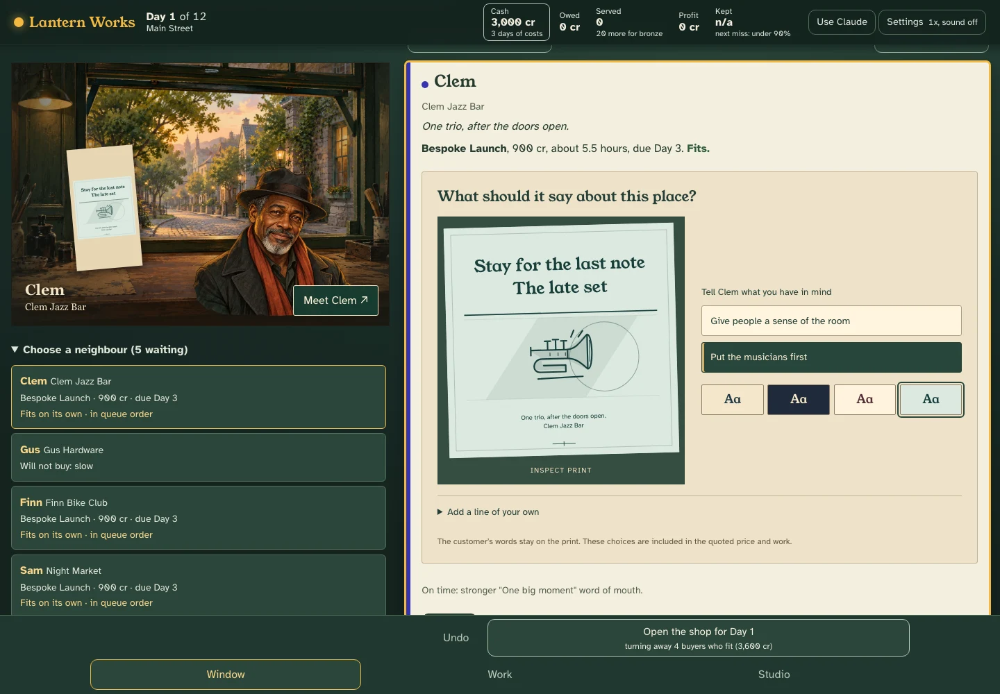
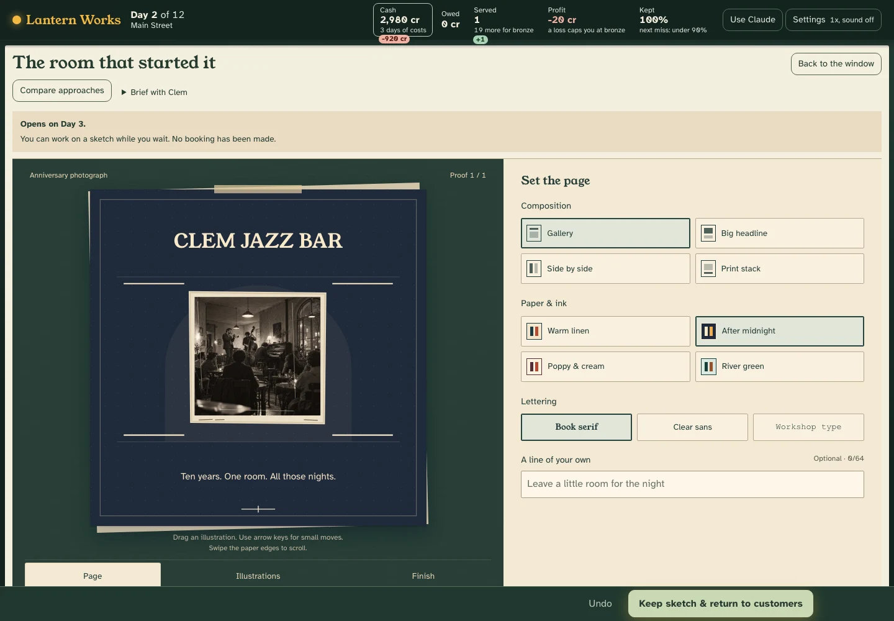
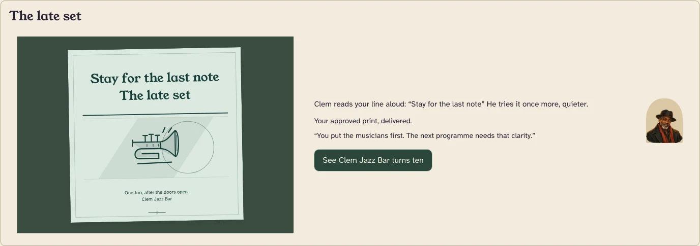

# Lantern Works

**Make something for your neighbours.**

A browser game about running a small creative studio. Meet the people on your street,
design their prints, and decide which promises your team can keep. The work you make
appears in their windows and becomes part of the neighbourhood.

**[Play Lantern Works](https://lantern-works-jlov7s-projects.vercel.app/)**



The whole game runs in your browser. **No account, API key or installation is needed
to play a hosted copy.** The AI desk inside the studio is a game mechanic. An optional
Claude writing helper is separate and is never required.

[Player guide](docs/public/PLAYER-GUIDE.md) · [Getting started](#run-locally) ·
[Troubleshooting](docs/public/TROUBLESHOOTING.md) · [How it works](docs/public/ARCHITECTURE.md)

## A studio with a life of its own

Clem needs a print for his jazz bar. Mara is finding a rhythm for her bakery.
Hugo has a workshop to hand over. Ask what matters to them, choose a direction,
and compose the actual piece: its words, colour, lettering and illustration.

Your team has a limited day. A careful maker, a quicker maker and a simulated AI
desk offer different ways to get the work done. A good promise has room for a redo.
Taking every order can cost more than turning one down.



A season lasts twelve in-game days. Your studio can continue through an opening,
a practice and a legacy, carrying selected work and relationships forward. Lend a
print, prepare a reusable pattern, teach an apprentice, or help the street put on
a gathering. After the authored career, you can keep an open studio.



Play at your own pace. Undo a decision, pause the workday, revisit a saved season,
or branch from a morning to try another plan. The illustrated studio is available
alongside the miniature 3D room. Settings include reduced motion and optional sound.

## Run locally

Install Node.js 24 and the pnpm version pinned in `package.json`, then run:

```sh
pnpm install --frozen-lockfile
pnpm dev
```

Open <http://localhost:5173>. Choose **First season: Main Street (guided)**.
The game saves in this browser as you play. Clearing site data removes those saves;
the [player guide](docs/public/PLAYER-GUIDE.md#keep-your-season) explains replay backups.

For the same static build that a host serves:

```sh
pnpm build
pnpm preview
```

Open <http://localhost:47613>. Production builds can work offline after the first
complete visit, while the browser retains their cached files.

## Host it

Lantern Works builds to ordinary static files in `dist/`. There is no game server,
database or model bill for normal play. Vercel can serve it with the included
configuration. See the [hosting guide](docs/public/HOSTING.md) for setup, updates
and the checks to run before sharing a link.

## For contributors

The engine is pure TypeScript. A saved season records the starting street and your
moves, so the same record reproduces the same results. React presents that state;
the 3D room and illustrated view show the same work. Saved seasons keep their
supported original rules.

```sh
pnpm exec playwright install chromium
pnpm verify
```

This runs TypeScript, lint, unit and replay tests, balance checks, a production build,
the loading-size budget, and browser tests. [Contributing](CONTRIBUTING.md) covers
the code layout and rules for changes. [Quality and limits](docs/public/QUALITY.md)
separates automated checks from the playtesting still to do.

## Data and optional AI

Saves and settings stay in your browser. The game has no analytics. Replay links
contain the season's moves and artwork, so share only what you intend someone else
to see. A hosting provider may keep ordinary access logs.

If you explicitly connect your own Anthropic key, Claude can draft an offer or
describe a finished season. Those requests go directly to Anthropic and are billed
to that key. The key is held in the tab's memory and forgotten on reload. Offline
versions of both features are included. See [security and privacy](SECURITY.md).

## Licence and artwork

The software code is available under the [MIT licence](LICENSE). Original artwork,
characters and game writing are reserved under the [content terms](CONTENT-LICENSE.md),
including where they appear inside source files. You may run the complete game
locally for personal use. Reusing the code does not grant a licence to publish a
copy with the reserved assets and story.

The painted scenes and portraits were made with AI image generation. The prints
combine those assets with code-drawn illustrations and the player's choices.
[Artwork provenance](docs/public/ARTWORK.md) identifies the assets; bundled libraries
and fonts retain their [own notices](public/THIRD-PARTY-NOTICES.txt).

<sub>Lantern Works is an independent, non-commercial personal research and development project. It is not associated with, endorsed by, or representative of any employer, client or partner. All people, businesses and events in the game are fictional. Its outcomes describe the game's rules, not business or financial advice.</sub>
