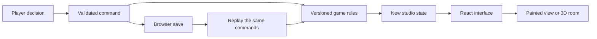

# How Lantern Works works

The browser contains the complete game. There is no server deciding what happens
and no language model in the simulation.

## A season is a record of decisions

`src/engine/` contains pure TypeScript. A starting configuration and an ordered
list of commands produce the season. Money uses integer credits; random draws
are keyed so replay does not depend on a clock or a browser's random generator.

The engine handles prices, work, deadlines, relationships and career continuity.
Advance payments remain owed until delivery. A failed promise is resolved by the
rules rather than by presentation code. Existing saved histories select supported
rules versions instead of silently adopting a later balance change.

## Views show the same work

`src/ui/` presents the engine state. The production timeline projects the day's
events into the miniature room or illustrated studio. Neither renderer owns a
second copy of the business simulation. Approved artwork travels through the
workday, delivery and portfolio as saved design data.

The title loads first. Heavier screens, graphics, replay workers and optional
Claude code load when needed. `scripts/size.mjs` checks the compressed JavaScript
needed for the initial render against a 150 kB budget.

## Saves and inputs

Browser storage holds local histories and settings. Saves and incoming replay
links are bounded and validated with Zod before replay. Long replays use workers
where supported, with recovery paths when restoration fails. A replay link carries
its data after `#`; normal HTTP requests do not send that fragment to the host.
The person you give the link to can still read its contents.

## Optional model calls

`src/ai/` defines two bounded tasks: an offer proposal and a debrief. Structured
responses are checked before use. The engine still determines whether an offer
sells and how work turns out. Browser requests use a player's explicitly supplied
key. The development bridge under `dev/` is restricted to local development and
is absent from the production output.

## Offline and hosting

Vite emits static files. A service worker caches a version's page and assets after
an online visit. New workers wait while existing tabs use the previous version.
Saves remain separate from those caches. See [HOSTING.md](HOSTING.md) for the
deployment procedure and [SECURITY.md](../../SECURITY.md) for data boundaries.
